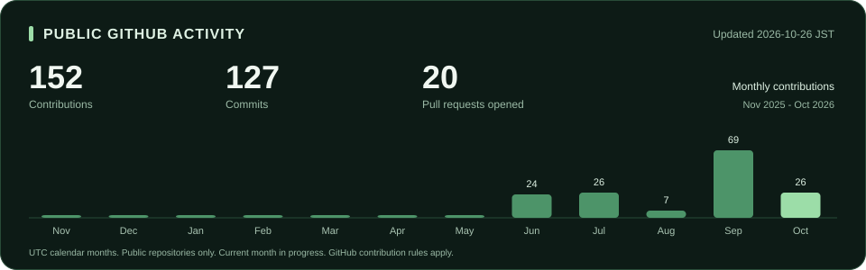

  

  <strong>農業と機械の経験を、使いやすいアプリづくりへ。</strong> 
  農業・ロボット・作業機械が好きです。現在はWeb・モバイルアプリの開発に取り組んでいます。

  <a href="#about">About</a> &nbsp; / &nbsp;
  <a href="#tech-stack">Tech Stack</a> &nbsp; / &nbsp;
  <a href="#activity">Activity</a> &nbsp; / &nbsp;
  <a href="#projects">Projects</a>

## About

機械系で学び、米国で農業に触れ、今はソフトウェアづくりを学んでいます。
機械や農業への関心を、現場での記録や操作の手間を減らすアプリにつなげたいと考えています。

| 機械を学ぶ | 農業の現場を知る | ソフトウェアをつくる |
| :--- | :--- | :--- |
| 桑名工業高校 機械科出身 四日市工業高校 専攻科（機械科）出身 | 米国で大規模農業・経営・マーケティングを学習 約1年の農業実習を経験 | 学校行事の運営アプリをチームで開発 農作業の記録アプリを制作 |

## Tech Stack

プロジェクトで使用している技術です。

## Activity

[公開したPull Requests](https://github.com/search?q=author%3Ahaya9830+is%3Apr&type=pullrequests) &nbsp; · &nbsp; [Repositories](https://github.com/haya9830?tab=repositories)

## Projects

### 🌾 Fuel Apply

**農作業の記録を、スマートフォンから。**

農作業用機械の稼働時間・給油量を入力し、OneDrive上のExcelに記録するアプリのMVPです。
農業用燃料の免税申請に必要な記録を、スマートフォンから入力できるようにすることを目指しています。

`TypeScript` `React Native` `Expo` `Microsoft Graph`

[Code & README →](https://github.com/haya9830/fuel_apply)

### 🏫 RecTime

**学校行事の運営を支える、チーム開発。**

Webアプリ [recwatch](https://github.com/HalNagoyaRecTime/recwatch) と、バックエンド [rectime-api](https://github.com/HalNagoyaRecTime/rectime-api) の開発に参加しています。
参加者選択の表示・検索改善、停止中の学生の扱い、行事スケジュール登録SQL、データ整理用マイグレーションとテストを担当しました。

`TypeScript` `React` `Hono` `Cloudflare Workers` `D1` `Vitest`

実装した変更：

- [クラスコードで参加者を探しやすくする](https://github.com/HalNagoyaRecTime/recwatch/pull/409)
- [停止中の学生を参加者候補から除外する](https://github.com/HalNagoyaRecTime/recwatch/pull/410)
- [検証環境の初期データを整理する](https://github.com/HalNagoyaRecTime/rectime-api/pull/559)
- [公式スケジュールの登録SQLを整える](https://github.com/HalNagoyaRecTime/rectime-api/pull/560)

### 🧩 Aptus

**PCパーツの互換性確認と、個人間売買の操作プロトタイプ。**

会員登録・ログイン、出品、カート、モック購入など、サービスの流れを画面で確認できるプロトタイプです。

[Code →](https://github.com/haya9830/aptus-mvp-prototype-ia12a203-10)
